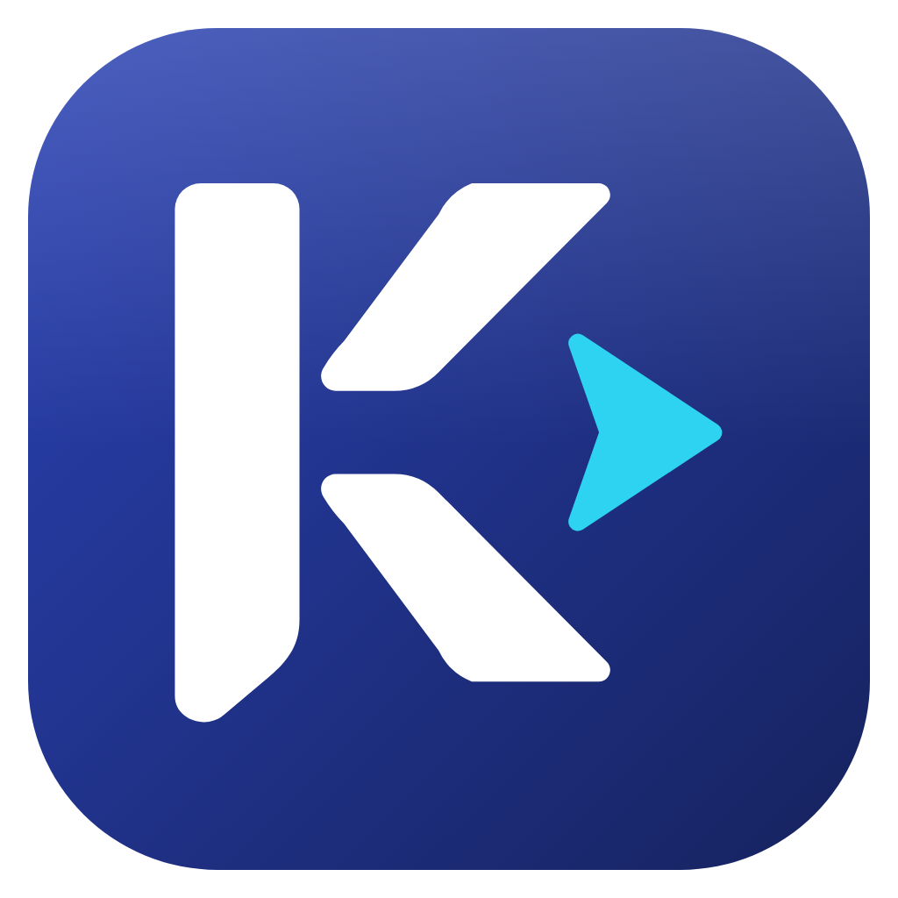
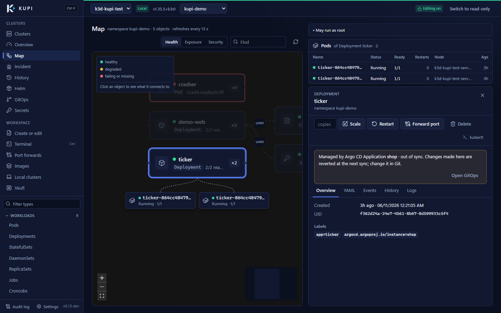
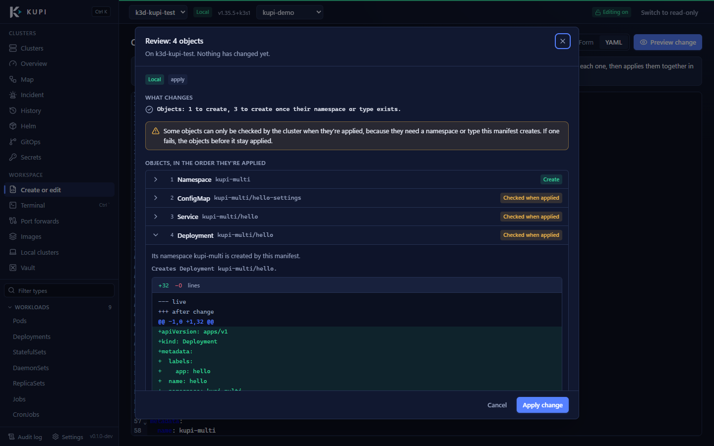
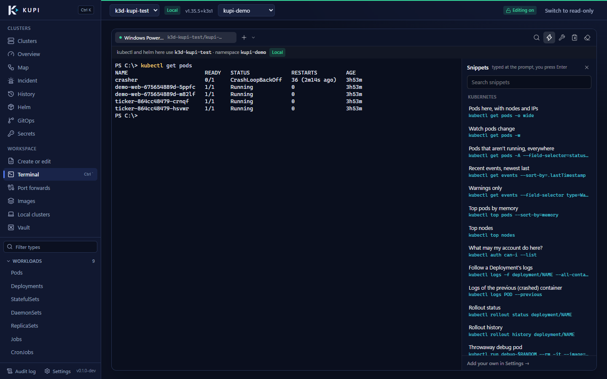
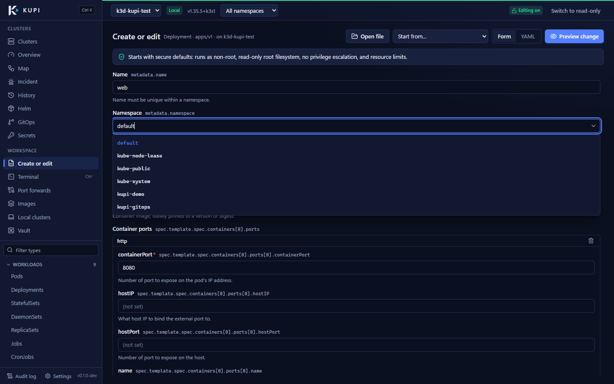
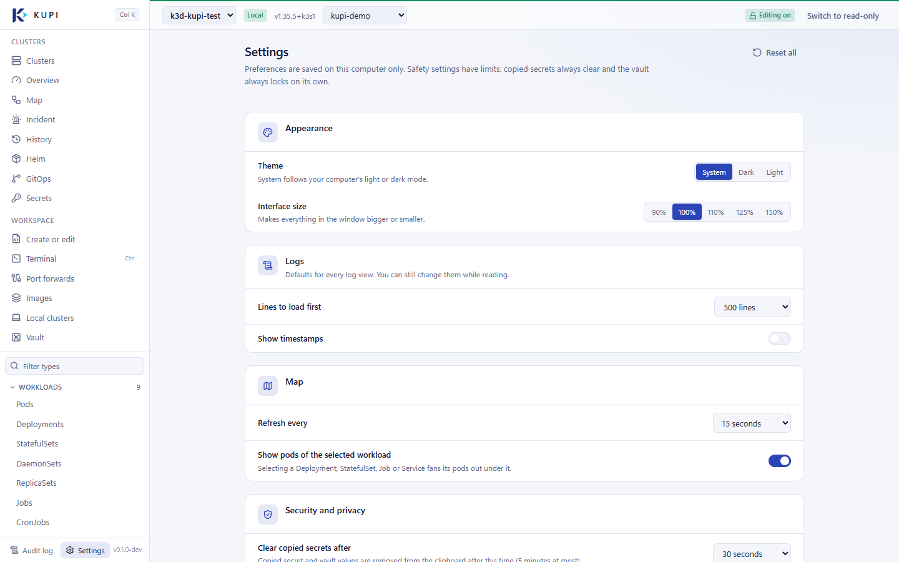

<div align="center">



# Kupi

**Kubernetes Pilot: a safe, fast desktop app for your clusters, from a laptop to production.**

[](https://github.com/ihebamiri/Kupi/actions/workflows/ci.yml)
[](https://github.com/ihebamiri/Kupi/actions/workflows/codeql.yml)
[](LICENSE)
[](go.mod)


[Features](#features) · [Download](#download) · [Safety](#safe-by-design) · [Build from source](#build-from-source) · [Docs](#documentation)



</div>

Kupi puts everything you need to run Kubernetes in one window: every resource type, logs, a shell, live metrics, a map of how things connect, Helm charts and releases, Argo CD and Flux, Secrets, local images and k3d clusters, and a terminal that follows the cluster you're working on. Every change goes through one checkpoint, with a dry run, a diff and an audit trail, so the same app is quick on your laptop and careful on production.

> **Status:** early development (v0.x). It's ready for local and test clusters; try it on production read-only first.

## Why Kupi

- **One interface for beginners and experts.** Real Kubernetes names, plain-language explanations, and YAML one click away.
- **Safe by design.** No change reaches a cluster without a preview: permission check, server-side dry run, diff and confirmation. Production clusters open read-only.
- **Adapts to the cluster.** Fast and direct on k3d; careful and explicit on staging and production, with reasons and typed confirmations.
- **Light.** Go and the system web view (WebView2, WebKitGTK), no bundled browser.
- **Private.** No telemetry, no accounts, no server. Your data stays on your computer.

## Features

### Explore and fix

- **Every resource type**, custom resources included, with the same columns as `kubectl get`, live updates, events, YAML, logs (one pod or a whole workload), a shell and CPU and memory charts (days of history when the cluster runs Prometheus).
- **Map** of how Ingresses, Services, workloads, ConfigMaps, Secrets and storage connect, with health, exposure and security overlays. Select a workload to see its pods, ask **"can A talk to B?"** of the NetworkPolicies, or **replay** recent changes on the map.
- **Incident view:** what's failing right now, the log lines that explain it, and what changed just before.
- **History** of every change while you're connected, with the tool that made it (kubectl, Helm, Argo CD…) and a diff.

### Change safely



- **Forms from the cluster's own schema**, kept in sync with a YAML editor. Fields suggest the namespaces, ConfigMaps, Secrets and other objects that exist; CPU, memory and replicas have sliders.
- **Whole manifests:** paste or open a file with many objects. Kupi checks each one and applies them in a safe order with one confirmation.
- **Scale, restart, delete, port-forward** from any object.
- **Helm:** install charts from Artifact Hub, chart repositories or OCI registries; edit values, change chart version, roll back or uninstall, each with a diff.
- **Argo CD and Flux:** status, sync, reconcile, suspend, resume. Changes to objects they manage become **GitHub pull requests** instead of edits that get reverted.

<br clear="right" />

### Secrets without leaks

- Values stay hidden until you reveal one key, and copies clear themselves (on Windows they're also kept out of clipboard history).
- Edits send only the keys you change. An exposure scan finds values leaked into annotations.
- A **local vault** keeps credentials encrypted on your computer (age, key in the OS password store).

### Work locally

- **Images:** browse local images, search Docker Hub, pull (with private registry logins from the vault), scan for vulnerabilities (Trivy), check signatures (cosign), load into a cluster, deploy.
- **k3d clusters:** create, start, stop, delete. **Laptop mode** caps a cluster's memory and CPU and stops it when idle.
- **Port forwards** that reconnect on their own, on 127.0.0.1 only.

### Terminal



An opt-in terminal with your own shell (PowerShell, bash…), switched on through a system dialog:

- kubectl and helm in each tab use the cluster and namespace Kupi is connected to, **without changing your kubeconfig**.
- Pastes that would run straight away, or delete things on production, are shown to you first.
- Snippets, search, tool versions and a kubectl version-skew check.

<br clear="right" />

<details>
<summary><b>More screenshots</b></summary>
<br />

| Form with suggestions | Settings (light theme) |
|---|---|
|  |  |

</details>

## Download

| Platform | Get it | Needs |
|---|---|---|
| Windows 10/11 (x64) | [Releases](https://github.com/ihebamiri/Kupi/releases): unzip and run `kupi.exe` | Microsoft Edge WebView2 (built into Windows 11) |
| Linux (x64) | [Releases](https://github.com/ihebamiri/Kupi/releases): AppImage, .deb, .rpm or .tar.gz | GTK 4.10+ and WebKitGTK 6.0 (Ubuntu 24.04, Debian 13, Fedora 40 or newer) |

Kupi reads your kubeconfig (`KUBECONFIG` or `~/.kube/config`) and never edits it. It supports Kubernetes 1.34 to 1.37. kubectl, Helm and Docker are optional: Kupi has its own Kubernetes client and Helm, and uses Docker or Podman only for local images and k3d clusters.

New here? The [user guide](docs/USER_GUIDE.md) walks through every page.

## Safe by design

| Protection | What it means |
|---|---|
| One checkpoint | Every change goes through the Guard: permission check (`SelfSubjectAccessReview`), server dry run, redacted diff, confirmation, then apply with the resourceVersion you reviewed, so nobody's newer change gets overwritten. |
| Profiles | Local, dev, staging, production. Unknown clusters are treated as production: read-only until you switch editing on, a reason for every change, typed names for deletes. |
| Audit log | Every change, reveal and shell session, hash-chained so edits to the log are detected. |
| Secrets | Values never travel to the UI unless you reveal one, never appear in diffs or logs, and copies clear themselves. |
| Hostile data | Cluster data is always shown as text, never HTML; a strict Content Security Policy; no remote code. |
| Credential plugins | Kubeconfig exec plugins run only after you trust that exact file, and trust breaks when it changes. |
| Enforced in code | Architecture tests fail the build if anything but the Guard can change a cluster, or anything runs a shell outside the opt-in terminal. |

The full model is in [How Kupi works](docs/ARCHITECTURE.md#10-security-model). To report a vulnerability, see [SECURITY.md](SECURITY.md).

## Build from source

Requirements: Go 1.26 or newer, Node 22, the [Wails v3](https://v3.wails.io) CLI, and on Linux `libgtk-4-dev` and `libwebkitgtk-6.0-dev`.

```bash
go install github.com/wailsapp/wails/v3/cmd/wails3@latest
```

```bash
git clone https://github.com/ihebamiri/Kupi.git && cd Kupi
```

```bash
wails3 dev
```

Build a release binary with `wails3 task windows:build` or `wails3 task linux:build` (it lands in `bin/`).

Tests:

```bash
go test ./...
```

```bash
cd frontend && npm test
```

Integration tests run against a local k3d cluster: `wails3 task cluster:up`, then `wails3 task test:integration`. If Go runs out of memory while building, add `-p 2`.

## Built with

[Go](https://go.dev) · [Wails v3](https://v3.wails.io) · [client-go](https://github.com/kubernetes/client-go) · [Helm SDK](https://helm.sh) · [React](https://react.dev) · [TypeScript](https://www.typescriptlang.org) · [Tailwind CSS](https://tailwindcss.com) · [CodeMirror](https://codemirror.net) · [xterm.js](https://xtermjs.org) · [React Flow](https://reactflow.dev) · [age](https://age-encryption.org)

## Documentation

- [User guide](docs/USER_GUIDE.md): where everything is and what it does.
- [How Kupi works](docs/ARCHITECTURE.md): the components, from the ground up.
- [Testing on Windows](docs/TESTING-WINDOWS.md): a step-by-step manual test with sample data.
- [Testing on Linux](docs/TESTING-LINUX.md): installing the Linux packages and what to check that differs from Windows.
- [Progress](docs/PROGRESS.md): what's done, verified and still to come.

## Roadmap

- Argo CD ApplicationSets, and pull requests for GitLab and other Git hosts.
- A "Build" canvas: drag workloads, Services and config together and get the YAML.
- A system tray with running port-forwards.

## Contributing

Issues and pull requests are welcome. Read [CONTRIBUTING.md](CONTRIBUTING.md) first: it explains how the code is organised and the security rules every change has to keep.

## License

Copyright 2026 Iheb Amiri. Licensed under the [Apache License 2.0](LICENSE).
